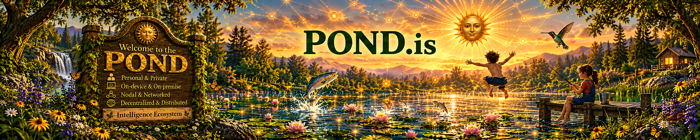

# POND: For a Human-Machine Intelligence Ecosystem

**The POND Principle:** a Human-Machine Intelligence (HMI) system that is

- **P**ersonal & Private
- **O**n-Device & On-Premise
- **N**odal & Networked
- **D**ecentralized & Distributed

> "POND is the community for thinkers, designers, builders and all people who support a personal, private, participatory future of distributed and decentralized Human-Machine intelligence."

## Why POND

> "Currently, AI is being developed as a vertical, centralized structure: ever larger AI models in always bigger data centers owned by a small number of companies."

That structure risks an extreme concentration of power and control. Cloud AI "will likely have an important role in any future global intelligence system. But it cannot be the only component." The POND Principle proposes "the shape of an alternative and a necessary counterbalance to centralized structures."

## What POND is

> "The POND is not one company, platform, protocol, or product. It is an emerging ecosystem of people, devices, models, companies, organizations and communities which together form intelligence systems that are based locally, connect voluntarily, and participate in larger networks without surrendering private data, identity, agency, and value to any centralized authority."

In practice that means intelligence that starts with the person and runs on hardware they control, where each person's environment is a **node**, and nodes connect **peer to peer** to share what's useful without sharing everything that's private.

## What we build and gather here

- Personal and private AI
- Local models and on-device intelligence
- Distributed agent and knowledge networks
- User-owned data, memory, identity, and context
- Open standards and interoperability
- Human–Machine collaborative intelligence
- Privacy-preserving computation

> "We value serious inquiry over hype, working systems over slogans, transparent economics over token speculation, and constructive criticism over ideological conformity."

## Repositories

- [**awesome-pond**](https://github.com/POND-is/awesome-pond): a curated list of open-source, local-first, personal and decentralized AI projects. Add yours with a pull request.
- [**pond-principle**](https://github.com/POND-is/pond-principle): the POND Principle text, open questions and [community Discussions](https://github.com/orgs/POND-is/discussions).

## On Hugging Face

- 🤗 [**POND-is on Hugging Face**](https://huggingface.co/POND-is): open models, datasets and Spaces for personal, on-device intelligence.
- 🧰 [**POND Starter Kit**](https://huggingface.co/collections/POND-is/pond-starter-kit-open-models-for-your-own-hardware): 13 open models for chat, code, vision, speech and memory that run on your own hardware. Suggest additions in [Discussions](https://github.com/orgs/POND-is/discussions).

## The POND Foundation

The POND Foundation "will be created to help build, nurture and cultivate this kind of ecosystem—not to own or control it," acting as "a gardener, convener, connector, and steward."

## Join the POND

- 🌐 Website: [pond.is](https://www.pond.is) · ✉️ [foundation@pond.is](mailto:foundation@pond.is)
- 💬 Discord: [discord.gg/kNvtcjPmJ7](https://discord.gg/kNvtcjPmJ7)
- 🎙️ [PONDcast](https://www.pond.is/p/pondcast-weekly-meeting-for-the-pond): weekly meeting, Thursdays at 6:30 PM PT on Discord
- 👽 Reddit: [r/PONDAI](https://www.reddit.com/r/PONDAI/)
- 𝕏 Community: [POND Intelligence (AI)](https://x.com/i/communities/1695429836993712389)
- 🤗 Hugging Face: [POND-is](https://huggingface.co/POND-is)
- 📝 Medium: [POND Foundation](https://medium.com/pond-foundation)
- 📄 Read: [POND: For a Human-Machine Intelligence Ecosystem](https://www.pond.is/p/pond-a-human-machine-intelligence)

> "The future of intelligence should not belong only to those who own the largest data centers. It should grow through the participation of people everywhere."

**Welcome to the POND. Let's grow something alive.**
